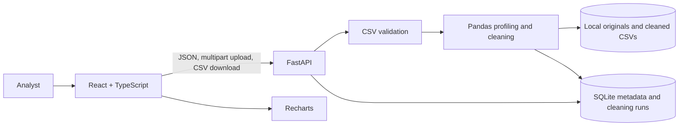

# Smart Data Quality & Insights Platform

A local-first web app for uploading CSV files, previewing their structure, finding common data-quality issues, applying explicit cleaning rules, comparing results, and exporting a separate cleaned CSV.

This is a hackathon MVP, not a production data-governance product. Analysis is heuristic, processing and storage are local to the API host, and there is no authentication or multi-user isolation.

## What it does

- Accepts UTF-8 CSV files and validates their headers, row structure, extension, size, row count, and column count.
- Stores an immutable original and dataset metadata.
- Previews a bounded, paginated set of rows.
- Reports missing cells, exact duplicate rows, detectable type inconsistencies, column type guesses, numerical summaries, and an explainable quality score.
- Applies opt-in cleaning rules to a separate copy: remove exact duplicate rows, keep/drop/fill/statistically impute missing values, trim whitespace, and standardize selected columns.
- Compares before/after counts, profiles the cleaned output, and downloads the latest cleaned CSV. Formula-leading values are escaped in exports.
- Builds charts from API summaries rather than embedding example chart values.

The included [demo CSV](./data/demo_quality_sample.csv) contains synthetic records, missing cells, an exact duplicate, mixed numeric values, and varied date/text formatting.

## Architecture



- **Frontend:** React, TypeScript, Tailwind CSS, Vite, and Recharts.
- **Backend:** FastAPI and Pydantic for HTTP validation and typed responses; Pandas for CSV parsing, profiling, and transformations; SQLAlchemy and SQLite for metadata.
- **Artifacts:** Original and cleaned files are stored under the configured local data directory. SQLite stores references, rules, and report snapshots. The API does not include server file paths in dataset responses.
- **Flow:** The frontend uploads a CSV; the API validates and persists it. Analysis reads the original without changing it. Cleaning always starts from the original, saves a separate output and run record, and returns a report for the cleaned output. Insights use the cleaned report after a run and original analysis before a run.

See [architecture details](./docs/architecture.md), [API design](./docs/api_design.md), and [database design](./docs/database_design.md).

## Requirements

- Python 3.11 or later recommended (the current development environment used Python 3.13).
- Node.js 22 recommended; the frontend test command uses Node's built-in TypeScript type stripping.
- npm.

## Clean setup

Run commands from this project directory (`smart-data-quality/`). In a clean checkout:

```bash
# Backend environment and dependencies
cd backend
python3 -m venv .venv
source .venv/bin/activate
python -m pip install --upgrade pip
pip install -r requirements.txt -r requirements-dev.txt
cp .env.example .env
cd ..

# Frontend dependencies
cd frontend
npm ci
cd ..
```

`.env` is optional; the defaults in `backend/app/core/config.py` and the checked-in `.env.example` are used if it is absent. Edit `backend/.env` to customize persistence and limits. Keep local `.env` files and data out of source control.

## Environment variables

| Variable | Default | Description |
|---|---|---|
| `APP_NAME` | `Smart Data Quality API` | FastAPI application title. |
| `LOG_LEVEL` | `INFO` | Backend log level. |
| `DATABASE_URL` | `sqlite:///./data/smart_data_quality.db` | SQLAlchemy database URL, relative to the backend working directory for this SQLite default. |
| `DATA_STORAGE_DIR` | `./data/uploads` | Directory for original uploads and cleaned results, relative to the backend working directory when given as a relative path. |
| `MAX_UPLOAD_SIZE_BYTES` | `26214400` (25 MiB) | Maximum uploaded file size. |
| `MAX_CSV_ROWS` | `100000` | Maximum data rows accepted per file. |
| `MAX_CSV_COLUMNS` | `1000` | Maximum columns accepted per file. |
| `MAX_PREVIEW_ROWS` | `100` | Maximum rows returned by one preview request. |

Set the same environment variables in the backend process environment to override `.env`. The frontend upload hint/check is currently fixed at 25 MB while the backend limit is configurable; keep them aligned when changing the backend cap.

## Run locally

Open two terminals in the project directory.

Terminal 1:

```bash
cd backend
source .venv/bin/activate
uvicorn app.main:app --reload --host 127.0.0.1 --port 8000
```

Terminal 2:

```bash
cd frontend
npm run dev -- --host 127.0.0.1 --port 5173
```

Open <http://127.0.0.1:5173>. Vite proxies `/api` and `/health` to FastAPI on port 8000. The backend creates its SQLite tables on startup. API docs are available at <http://127.0.0.1:8000/docs>, and `GET /health` should return `{"status":"ok"}`.

## Test and build

```bash
# Backend tests
cd backend
source .venv/bin/activate
python -m pytest -q
cd ..

# Frontend regression tests and production type-check/build
npm --prefix frontend test
npm --prefix frontend run build
```

For a quick API smoke check with the supplied sample:

```bash
curl -F 'file=@data/demo_quality_sample.csv' http://127.0.0.1:8000/api/datasets
```

Use the returned `dataset_id` for preview, analyze, and clean requests. A complete scripted UI walkthrough is in [docs/demo_script.md](./docs/demo_script.md); expanded input coverage is in [docs/test_scenarios.md](./docs/test_scenarios.md).

## Data quality score

The report starts at 100 and subtracts three proportional penalties:

- Missing cells: up to 40 points, scaled by missing cells / all cells.
- Exact duplicate rows: up to 30 points, scaled by duplicate rows / all rows.
- Inconsistent values: up to 30 points, scaled by inconsistent values / all cells.

Each penalty is rounded half-up to two decimals; the final score is clamped at zero. Empty and whitespace-only cells count as missing. Literal `NA`, `null`, and `N/A` are not treated as missing by this application. The report returns each component and its rule, so the score can be explained. It is an indicator, not a certification of correctness.

## Handling unfamiliar datasets and errors

The backend does not map fields to business-specific names. It evaluates columns from their values and reports generic inferred types. A type is inferred from detectable numeric, boolean, date, and string values; when multiple types occur, a 60% dominant-type threshold is used to distinguish a likely inconsistency from a `mixed` column. These rules cannot determine whether a valid-looking value is meaningful for a particular organization.

Errors use a common JSON envelope with a stable code and message. Input errors include invalid extension/encoding/headers/rows, size or configured row/column limits, and invalid cleaning options. Missing datasets and absent cleaning runs return not-found responses. Unexpected errors return a generic message and request ID while diagnostics are logged by the API; do not put sensitive cell values in logs or demos.

## Limitations

- CSV only; uploads must be UTF-8. XLSX, database connectors, and cloud storage are not implemented.
- Type inference and quality scoring are heuristic, schema-agnostic signals. There are no user-defined constraints, referential integrity checks, semantic validation, or automatic category normalization.
- Locale-formatted numbers (for example `1,234.50` or `8,25`) are not automatically parsed during number standardization. The conversion is rejected rather than guessed.
- Date detection and parsing are heuristic. Ambiguous dates such as `01/02/03` may have multiple interpretations; inspect before standardizing.
- Data is persisted on the API host in SQLite and local files. There is no authentication, authorization, tenant separation, encryption-at-rest configuration, or collaborative review workflow.
- Upload handling reads the request into memory up to the configured size cap before validation. Large-scale streaming ingestion, background jobs, quotas, retention/deletion UI, and multi-host storage are not provided.
- No production deployment, load, security, backup/restore, or privacy certification is claimed.

## Demo materials

- [Three-minute walkthrough](./docs/demo_script.md)
- [Likely judge questions and grounded answers](./docs/judge_questions.md)
- [Normal, edge, and changed-input scenarios](./docs/test_scenarios.md)
- [Synthetic sample CSV](./data/demo_quality_sample.csv)
