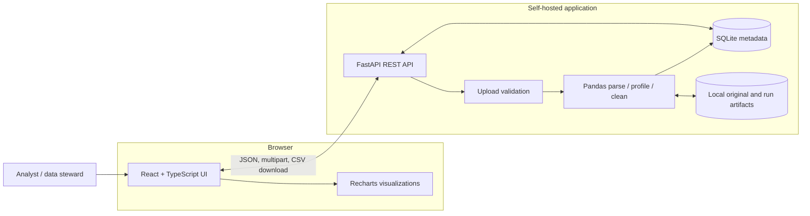
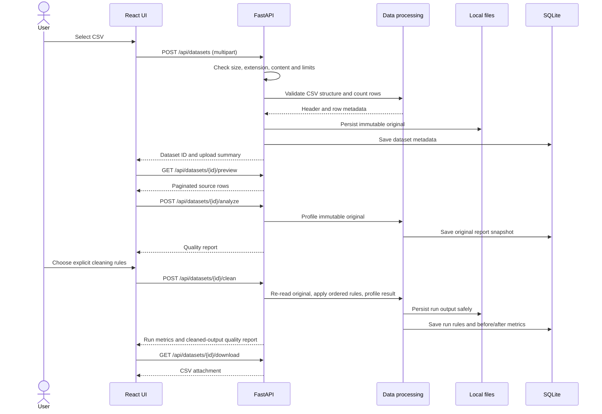

# System architecture

## Overview

The MVP is a browser-based React application backed by a same-origin-friendly FastAPI service. The API validates CSV files against configured size/row/column limits. Pandas performs parsing, profiling, and deterministic cleaning. SQLite stores dataset metadata, an original quality-report snapshot, and cleaning-run rules/counts/metrics; original and cleaned CSV artifacts live in an application-managed local data directory. The application has no external data-processing integration.

### Component diagram



### Upload-to-download data flow



## Responsibilities and boundaries

- **Frontend:** upload interaction, paginated preview, rule selection, quality comparison, accessible charts, and download initiation. It is not authoritative for validation or cleaning.
- **FastAPI:** versioned HTTP contract, request validation, size limits, error mapping, and orchestration. It must not expose server file paths.
- **Processing services:** Pandas parsing, missing/duplicate analysis, rule validation/application, report generation, CSV serialization, and export-safety handling. Keep transformations deterministic and separately testable.
- **Quality analysis:** reads the original artifact, derives schema-agnostic profiles and a documented heuristic score, and stores the original report snapshot in dataset metadata without modifying CSV contents.
- **Cleaning operations:** validate explicit rules, always transform the original artifact into a separate run artifact, record parameters and before/after metrics in SQLite, and return a full report for the formula-safe output. The latest-run endpoint can reconstruct that report from the saved output.
- **Persistence:** SQLite is authoritative for dataset/run metadata and original report snapshots. Filesystem artifacts are referenced by generated relative paths; filenames supplied by clients are display metadata only.
- **Storage lifecycle:** only mark an upload/run ready after its file and metadata are successfully persisted. On failures, remove partial files and return an error. The current MVP does not provide a dataset deletion or retention API.

## Project structure

```text
smart-data-quality/
├── README.md
├── docs/
│   ├── requirements.md
│   ├── architecture.md
│   ├── api_design.md
│   ├── database_design.md
│   ├── demo_script.md
│   ├── judge_questions.md
│   └── test_scenarios.md
├── data/
│   └── demo_quality_sample.csv
├── frontend/
│   ├── package.json
│   ├── package-lock.json
│   └── src/
└── backend/
    ├── .env.example
    ├── requirements.txt
    ├── requirements-dev.txt
    ├── app/
    │   ├── api/routers/
    │   ├── core/
    │   ├── database/
    │   ├── models/
    │   ├── schemas/
    │   └── services/
    └── tests/
```

## Deployment and configuration direction

- Run the Vite development server separately from Uvicorn during development; configure the dev proxy or CORS for the API origin.
- In deployment, serve the built frontend and API behind one origin or a reverse proxy.
- Keep the SQLite database and file directory outside the static web root. Exclude both from version control and backups unless retention is intended.
- Configure upload limits and the persistent data directory through backend environment settings.
- Back up the database and artifact directory together; restoring only one can leave broken artifact references.
- Do not use SQLite/local filesystem as a shared multi-host storage mechanism.
