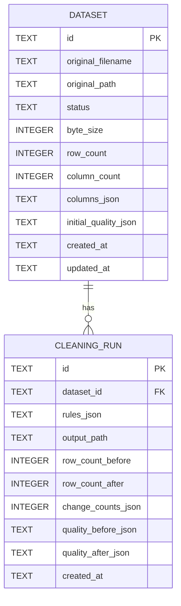

# Database design

## Persistence choices

SQLite stores metadata and compact quality-report snapshots. CSV contents remain in application-managed files, not database blobs. Store generated relative artifact paths only; never use a client-supplied filename as a path. A deployment must keep the database and artifact directory together and protect both as sensitive user data.

Enable `PRAGMA foreign_keys = ON` for every connection. Use parameterized SQL and transactions. Timestamps are UTC ISO 8601 strings. UUIDs are generated by the application.

## Entity relationship diagram

## Tables

### `datasets`

One row per accepted upload.

| Column | SQLite type | Constraints / meaning |
|---|---|---|
| `id` | `TEXT` | Primary key; application-generated UUID. |
| `original_filename` | `TEXT` | Sanitized display name only; not a storage path. |
| `original_path` | `TEXT` | Unique generated relative path to the immutable source artifact. |
| `status` | `TEXT` | `processing`, `ready`, or `failed`; only `ready` datasets may be previewed/cleaned. |
| `byte_size` | `INTEGER` | Original size in bytes; non-negative. |
| `row_count` | `INTEGER` | Parsed data rows, excluding header; non-negative when ready. |
| `column_count` | `INTEGER` | Accepted header count; positive when ready. |
| `columns_json` | `TEXT` | Ordered JSON string array of validated header names. |
| `initial_quality_json` | `TEXT` | Original quality report snapshot used for comparisons. |
| `created_at` | `TEXT` | UTC ISO 8601 creation time. |
| `updated_at` | `TEXT` | UTC ISO 8601 last state change. |

### `cleaning_runs`

One row per successful cleaning operation; failed or invalid attempts do not create a successful run.

| Column | SQLite type | Constraints / meaning |
|---|---|---|
| `id` | `TEXT` | Primary key; application-generated UUID. |
| `dataset_id` | `TEXT` | Required foreign key to `datasets.id`, `ON DELETE CASCADE`. |
| `rules_json` | `TEXT` | Validated rules as applied, including explicit fill values. |
| `output_path` | `TEXT` | Unique generated relative path to this run's cleaned CSV. |
| `row_count_before` | `INTEGER` | Original row count for this run. |
| `row_count_after` | `INTEGER` | Output row count; may be zero. |
| `change_counts_json` | `TEXT` | Counts for standardized cells, filled cells, dropped missing rows, dropped duplicates, and export-safety escapes. |
| `quality_before_json` | `TEXT` | Before-run row, missing-cell, and duplicate counts. |
| `quality_after_json` | `TEXT` | After-run row, missing-cell, and duplicate counts. |
| `created_at` | `TEXT` | UTC ISO 8601 creation time. |

## Indexes and integrity

- `datasets.original_path` is `UNIQUE`.
- `cleaning_runs.output_path` is `UNIQUE`.
- Index `cleaning_runs(dataset_id, created_at)` supports listing runs in chronological order.
- Models define `CHECK` constraints for non-negative byte/row/column counts and allowed dataset statuses.
- The cleaning-run foreign key uses `ON DELETE CASCADE`; an application-level dataset deletion operation is not currently exposed.
- Insert dataset metadata and update lifecycle state transactionally. Write artifacts through temporary generated paths and atomically rename before marking records ready.
- Each cleaning request always reads the immutable original. Its validated request is persisted in `rules_json`; its separate generated output is recorded by `output_path`.

## Retention and deletion

The original is retained while its dataset exists; each successful run artifact and its counts/rules are retained with it. The full original quality report is stored in `datasets.initial_quality_json`. The full cleaned-output report is calculated from the saved cleaned artifact when a cleaning run is returned or restored; the run table stores before/after aggregate metrics, not a second full quality report. Dataset deletion and automatic retention expiry are not implemented. Operators must protect storage and include both SQLite and artifacts in backups.

## Deliberate omissions

No separate `users` table (single-user MVP), `columns` table (ordered column metadata is stored as JSON), `quality_issues` row-per-cell table (reports are aggregate snapshots), or embedded CSV data table is needed initially. If future queries need filtering/grouping by column metrics or row-level issue navigation, normalize those structures in a later migration.
